<p align="center">
  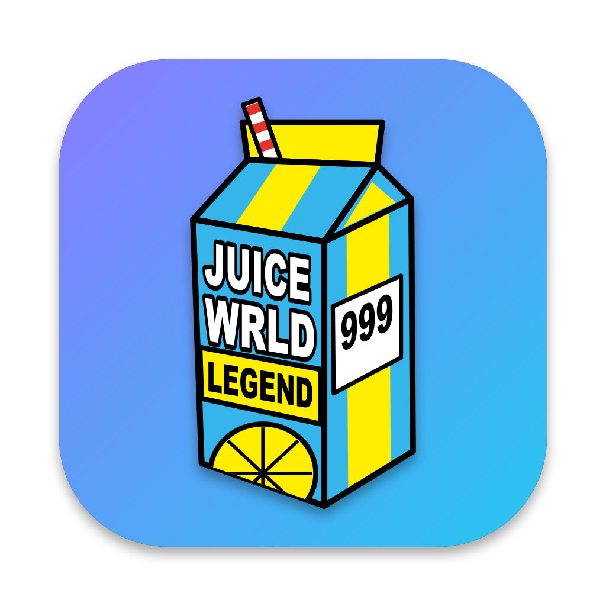
</p>

<h1 align="center">JuiceDownloader</h1>

<p align="center">
  <b>Every Juice WRLD track, one click away.</b><br>
  A desktop client for the <a href="https://juicewrldapi.com">Juice WRLD API</a>, for Windows, macOS and Linux: tick what you want, press Download.
</p>

<p align="center">
  
  
  
  
  
  <a href="LICENSE"></a>
</p>

<p align="center">
  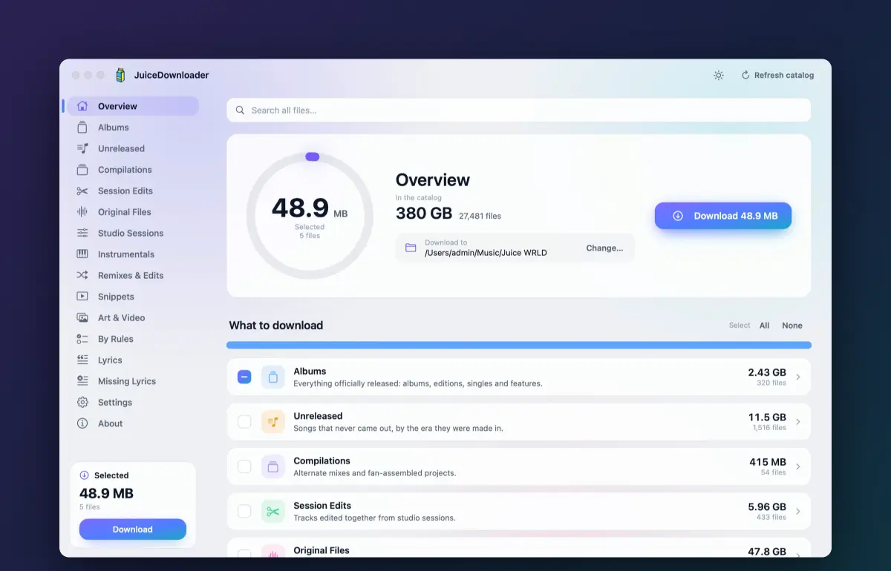
</p>

## What it does

The sidebar follows the API's own catalog, about 27,000 files and 380 GB:

| Page | What is on it |
|:--|:--|
| **Albums** | everything officially released: albums, editions, singles, features |
| **Unreleased** | songs that never came out, by era |
| **Compilations** | alternate mixes and assembled projects |
| **Session Edits** | tracks edited together from studio sessions |
| **Original Files** | the files as they surfaced, MP3 and WAV |
| **Studio Sessions** | Pro Tools sessions in ZIP archives, 174 GB in all |
| **Instrumentals**, **Remixes & Edits**, **Snippets** | what the names say |
| **Art & Video** | cover art, footage, photos |

- **One click.** Tick a whole page on the Overview, an album on its page, or open the album and tick single tracks. Download puts them in the folder you chose, in the catalog's folders.
- **Picks up where it stopped.** A file only takes its real name once every byte is there. Stop, close the app or lose the connection, and the next run resumes by byte range and skips what is finished.
- **Sizes up front.** Folder sizes and file counts are all there before you start, and a selection bigger than the free space is called out.
- **Listen and look first.** Songs play right in the app, from the catalog or your copy. Space opens a picture, a video or a text file like Quick Look, before anything is downloaded.
- **Right-click anything** to see where it lives, where else the song turns up, its other versions and its lyrics. A search result shows its path.
- **English and Russian**, dark and light themes, the same design on all three systems.

## Download by rules

The catalog holds 1,511 unreleased files of about 1,000 songs, plus raw stems and sessions. **By Rules** turns that into what you actually want: by default every unreleased song in its most finished version, and every session edit, with exact copies left out. That is about 1,475 MP3s, 13.8 GB, in one folder. Switches decide on demos of songs that came out and on unfinished songs, and each song can be set to another version.

## Lyrics add-on

Off by default, one switch on the Lyrics page. It finds the words **through the same API** and puts them on your files:

- `USLT` in MP3, leaving every other tag alone, and `name.lrc` (timed) or `name.txt` beside the file. WAV, M4A and AIFF get the file beside them, since their tags are not written.
- **Matched to the recording.** A session edit takes the recording session's words; a file that names a version takes that version or none; an instrumental takes nothing. Wrong words are worse than no words. The rules are in [docs/architecture.md](docs/architecture.md).
- **Add lyrics to a folder** does the same for music you already have, and lists what it could not place.
- **Missing Lyrics** lists what has no words, and session files that only have the finished song's, and asks LRCLIB, NetEase, Genius and lyrics.ovh about them. On Linux, playing music and watching video needs `mpv`.

## See it work

| Download by rules | Preview before downloading |
|:--:|:--:|
| 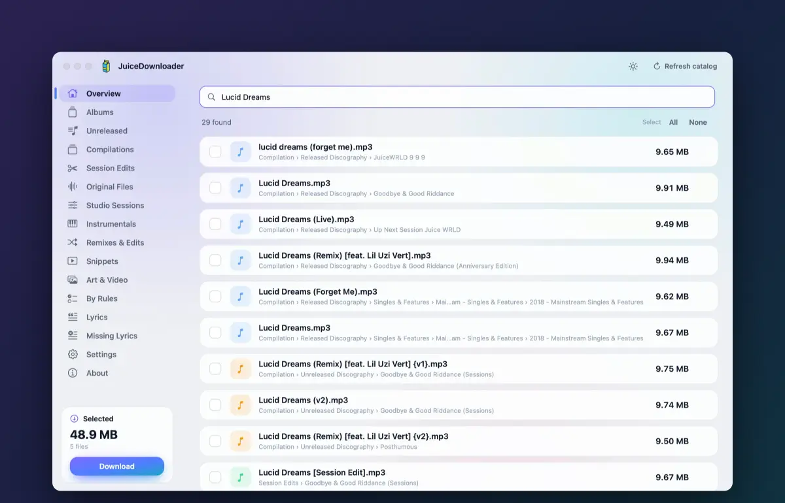 | 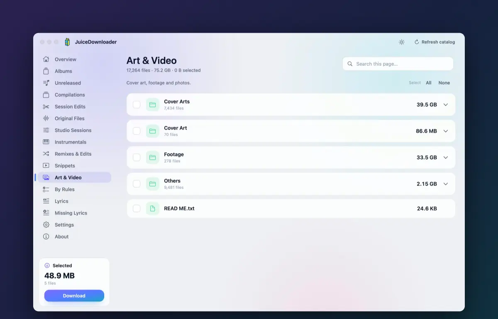 |

<p align="center">
  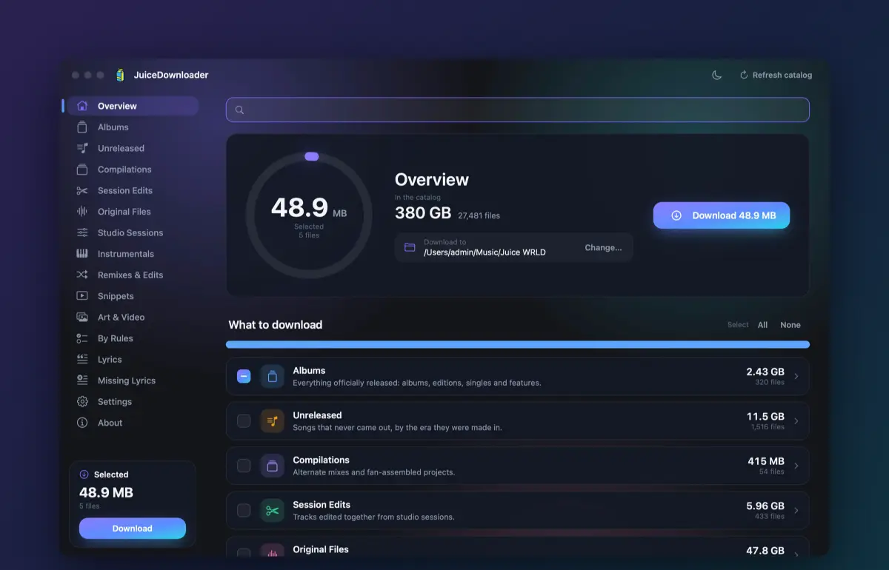<br>
  <sub>And click the juice box. Just because.</sub>
</p>

## Screenshots

| Albums | Lyrics |
|:--:|:--:|
| 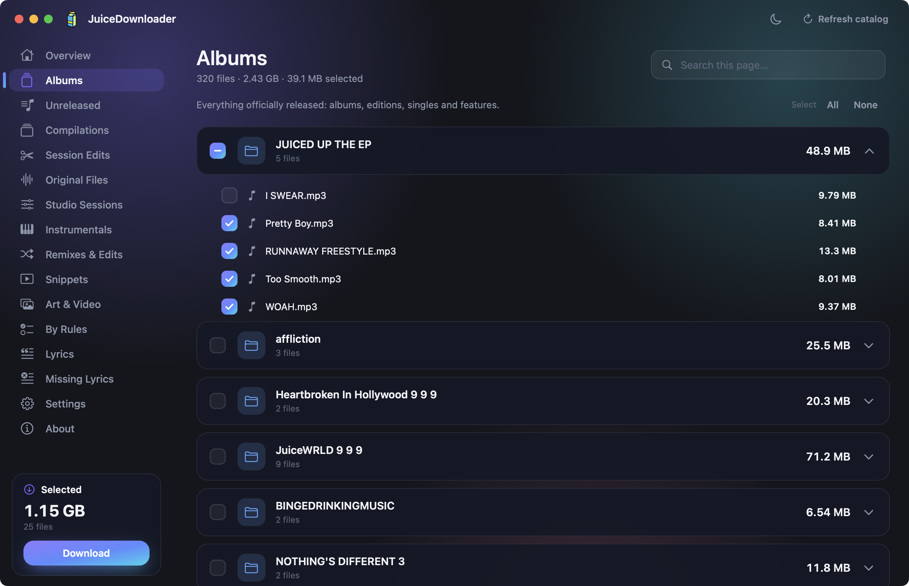 | 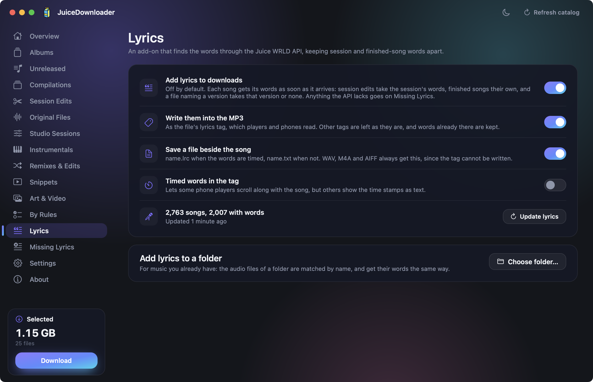 |

| Download by rules | Player |
|:--:|:--:|
| 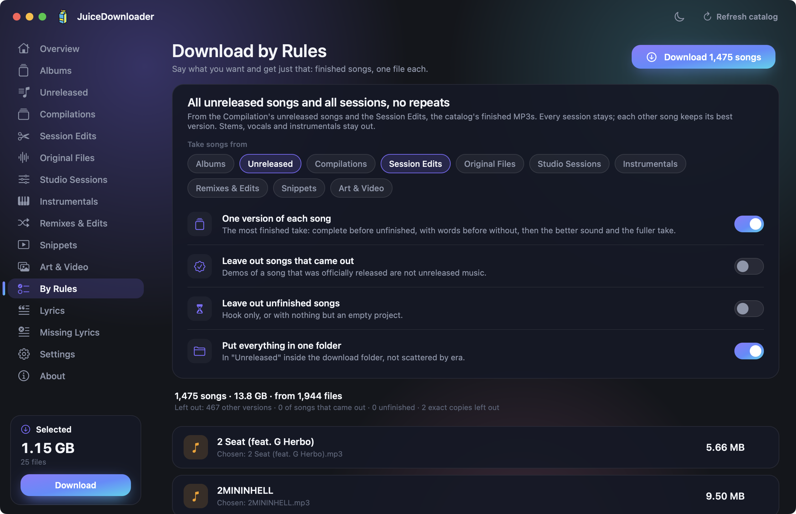 | 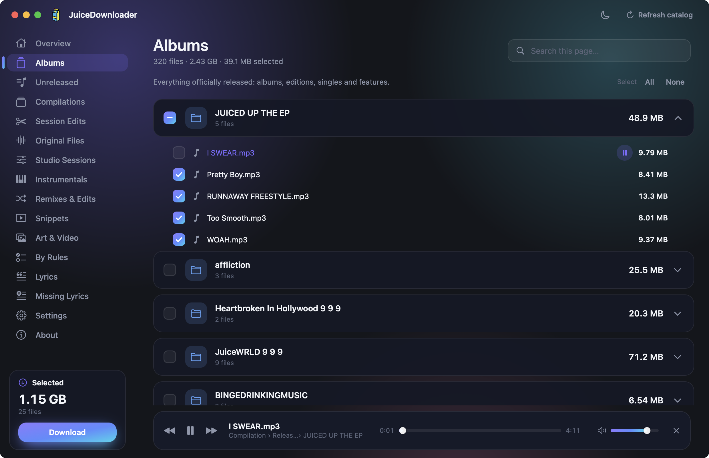 |

| Downloading | Linux |
|:--:|:--:|
| 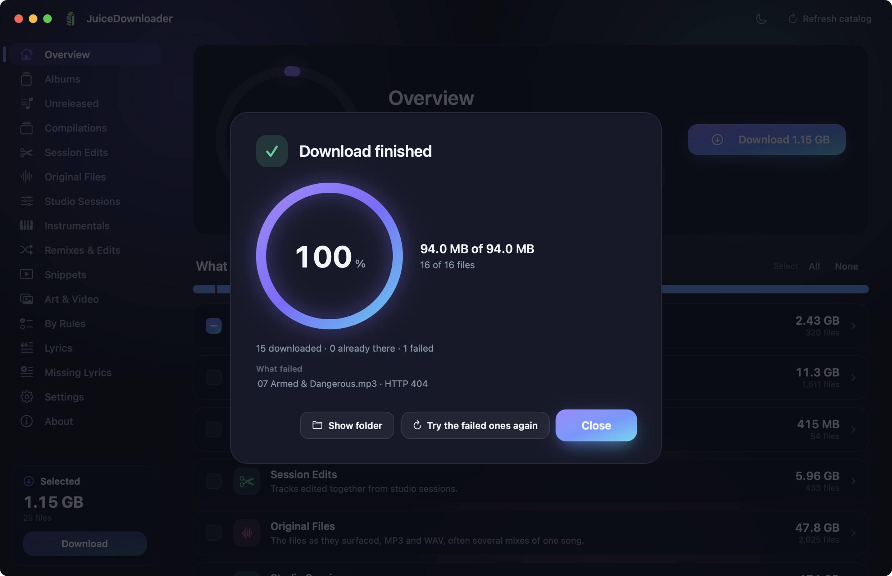 | 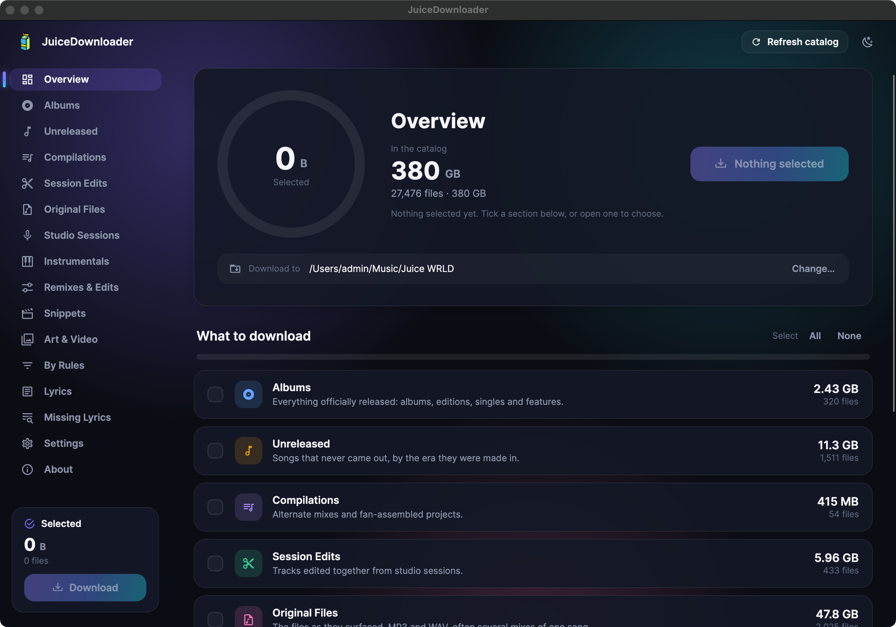 |

## Download

Packages are on the [Releases](https://github.com/Kreal-exe/JuiceDownloader/releases) page: one `.exe` for Windows, one `.dmg` for macOS, one `.AppImage` for Linux. None needs .NET. They are not signed yet; the release notes say how to get past the warnings.

## Build from source

```powershell
.\build.ps1 -Test      # Windows: .NET 10 SDK. Puts the exe on the Desktop.
```

```bash
./build.sh --test      # macOS: Xcode Command Line Tools only. Installs into /Applications.
```

```bash
./build-linux.sh --test    # Linux: .NET 10 SDK.
```

## Project layout

```
src/JuiceDownloader/Core   the engine shared by Windows and Linux: catalog, downloads, lyrics, ID3
src/JuiceDownloader        the Windows app (WPF)
LinuxApp                   the Linux app (Avalonia)
MacApp                     the macOS app (Objective-C / AppKit), with its own port of the engine
tests/fixtures             lyrics cases both engines must pass
docs/architecture.md       what was learned about the API, and how the app uses it
```

## About the music

This app hosts nothing. Everything comes from [juicewrldapi.com](https://juicewrldapi.com), a fan project this app is not part of, so please go easy on it. Much of the catalog is unreleased material whose rights belong to others: what you download is your own responsibility.

## License

The app's code is [MIT](LICENSE). That covers this code only, not the music.
